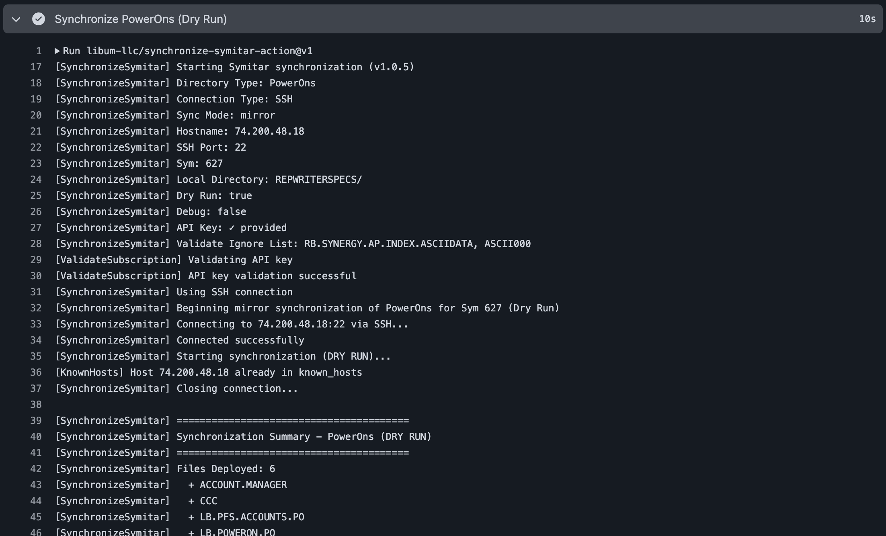

[](https://github.com/libum-llc/synchronize-symitar-action/releases/latest)
[](https://github.com/marketplace/actions/synchronize-symitar)
[](https://github.com/libum-llc/synchronize-symitar-action/actions?workflow=ci)

## About

GitHub Action to synchronize a directory on the Jack Henry™ credit union core platform



---

- [Usage](#usage)
  - [Symitar Connection and Host Trust](#symitar-connection-and-host-trust)
  - [Basic Example](#basic-example)
  - [Synchronizing Other Directory Types](#synchronizing-other-directory-types)
  - [Using Mirror Mode](#using-mirror-mode)
  - [Preserving Server-Managed Files](#preserving-server-managed-files)
  - [Pulling Preserved Files Back to Git](#pulling-preserved-files-back-to-git)
  - [Opening a Pull Request Instead of Committing](#opening-a-pull-request-instead-of-committing)
  - [Drift Detection](#drift-detection)
  - [Release Pipeline with Environment Approvals](#release-pipeline-with-environment-approvals)
- [List Inputs](#list-inputs)
- [Customizing](#customizing)
  - [Inputs](#inputs)
  - [Outputs](#outputs)
  - [Secrets](#secrets)
- [Contributing](#contributing)

## Usage

This action must run on a self-hosted runner with network access to the Symitar host.
The examples below use `runs-on: self-hosted`; if your organization uses runner labels,
include the label for the runner that can reach Symitar.

### Symitar Connection and Host Trust

The Symitar connector uses SSH in v2.2; this does not restrict future protocols. `connection-type` and `symitar-app-port` remain accepted but are ignored in this release. Omit them from new workflows. A future protocol selection must not silently reinterpret retained legacy values.

Provide both AIX/SSH and Symitar credentials. Set `ssh-host-key` to the base64 field of an administrator-approved SSH public key, or provision the agent service account's `~/.ssh/known_hosts` with `ssh-keygen` available. The key is not a private key, a SHA256 fingerprint, or a complete `known_hosts` line. Unknown or changed trust fails with an error; the action never prompts for `yes` or accepts a new key automatically.

Examples use `vars.SYMITAR_SSH_HOST_KEY` for that approved public value. `api-key` still requires a valid PowerOn Pipelines key.

### Basic Example

```yaml
name: Deploy PowerOns

on:
  push:
    branches: [main]
    paths:
      - 'REPWRITERSPECS/**'

jobs:
  deploy:
    runs-on: self-hosted
    steps:
      - name: Checkout code
        uses: actions/checkout@v4

      - name: Synchronize PowerOns
        uses: libum-llc/synchronize-symitar-action@v2
        with:
          directory-type: powerOns
          symitar-hostname: symitar.example.com
          sym-number: 627
          symitar-user-number: 1995
          symitar-user-password: ${{ secrets.SYMITAR_USER_PASSWORD }}
          ssh-username: libum
          ssh-password: ${{ secrets.SSH_PASSWORD }}
          ssh-host-key: ${{ vars.SYMITAR_SSH_HOST_KEY }}
          api-key: ${{ secrets.API_KEY }}
          sync-mode: push
          dry-run: false
```

### Synchronizing Other Directory Types

```yaml
jobs:
  deploy:
    runs-on: self-hosted
    steps:
      - name: Synchronize LetterFiles
        uses: libum-llc/synchronize-symitar-action@v2
        with:
          directory-type: letterFiles
          symitar-hostname: symitar.example.com
          sym-number: 627
          symitar-user-number: 1995
          symitar-user-password: ${{ secrets.SYMITAR_USER_PASSWORD }}
          ssh-username: libum
          ssh-password: ${{ secrets.SSH_PASSWORD }}
          ssh-host-key: ${{ vars.SYMITAR_SSH_HOST_KEY }}
          api-key: ${{ secrets.API_KEY }}
          sync-mode: push
          dry-run: false
```

Supported `directory-type` values are `powerOns`, `letterFiles`, `dataFiles`, and `helpFiles`.
Use `local-directory-path` when your repo path does not match the default for that type.

### Using Mirror Mode

Mirror mode makes Symitar match the local directory, including deleting extra files on Symitar.

```yaml
jobs:
  deploy:
    runs-on: self-hosted
    steps:
      - name: Mirror PowerOns
        uses: libum-llc/synchronize-symitar-action@v2
        with:
          directory-type: powerOns
          symitar-hostname: symitar.example.com
          sym-number: 627
          symitar-user-number: 1995
          symitar-user-password: ${{ secrets.SYMITAR_USER_PASSWORD }}
          ssh-username: libum
          ssh-password: ${{ secrets.SSH_PASSWORD }}
          ssh-host-key: ${{ vars.SYMITAR_SSH_HOST_KEY }}
          api-key: ${{ secrets.API_KEY }}
          sync-mode: mirror
          dry-run: false
```

### Preserving Server-Managed Files

Use `preserve-server-files` for generated or server-managed files. In `push` and `mirror` mode, matching server files are not overwritten or deleted.

```yaml
jobs:
  deploy:
    runs-on: self-hosted
    steps:
      - name: Mirror PowerOns while preserving server-managed files
        uses: libum-llc/synchronize-symitar-action@v2
        with:
          directory-type: powerOns
          symitar-hostname: symitar.example.com
          sym-number: 627
          symitar-user-number: 1995
          symitar-user-password: ${{ secrets.SYMITAR_USER_PASSWORD }}
          ssh-username: libum
          ssh-password: ${{ secrets.SSH_PASSWORD }}
          ssh-host-key: ${{ vars.SYMITAR_SSH_HOST_KEY }}
          api-key: ${{ secrets.API_KEY }}
          sync-mode: mirror
          dry-run: false
          preserve-server-files: |
            - RD.*
            - PFR.*
```

### Pulling Preserved Files Back to Git

Use `pull-preserved-only` to download only files matched by `preserve-server-files`. With no preservation patterns, a preserved-only pull downloads nothing. Enable `commit-pulled-changes` when the action should commit and push those changes.

```yaml
on:
  workflow_dispatch:
    inputs:
      commit_branch:
        description: Branch to compare against and commit pulled changes to
        type: string
        default: main

jobs:
  pull-server-managed:
    runs-on: self-hosted
    permissions:
      contents: write
    steps:
      - name: Checkout code
        uses: actions/checkout@v4
        with:
          ref: ${{ inputs.commit_branch || 'main' }}

      - name: Pull server-managed PowerOns
        uses: libum-llc/synchronize-symitar-action@v2
        with:
          directory-type: powerOns
          symitar-hostname: symitar.example.com
          sym-number: 627
          symitar-user-number: 1995
          symitar-user-password: ${{ secrets.SYMITAR_USER_PASSWORD }}
          ssh-username: libum
          ssh-password: ${{ secrets.SSH_PASSWORD }}
          ssh-host-key: ${{ vars.SYMITAR_SSH_HOST_KEY }}
          api-key: ${{ secrets.API_KEY }}
          sync-mode: pull
          dry-run: false
          preserve-server-files: |
            - RD.*
            - PFR.*
          pull-preserved-only: true
          commit-pulled-changes: true
          commit-branch: ${{ inputs.commit_branch || 'main' }}
```

When `commit-branch` is set, `actions/checkout` must check out the same branch. Drive both values from the same input or variable so they cannot drift. The action fails if the checked-out branch and `commit-branch` do not match.

### Opening a Pull Request Instead of Committing

For protected branches, set `create-pull-request: true` instead of `commit-pulled-changes`. The action commits the pulled changes to `pull-request-branch`, force-pushes it with `--force-with-lease`, and opens a pull request into `pull-request-target-branch` — or reuses the pull request that is already open for that same head and base, so a scheduled workflow does not accumulate duplicates.

`create-pull-request` and `commit-pulled-changes` are mutually exclusive, and both require `sync-mode: pull`. Neither does anything during a dry run.

```yaml
jobs:
  pull-server-managed:
    runs-on: self-hosted
    permissions:
      contents: write
      # Required. The default GITHUB_TOKEN cannot open a pull request without
      # it, and the run fails rather than silently skipping the pull request.
      pull-requests: write
    steps:
      - name: Checkout code
        uses: actions/checkout@v4
        with:
          # Required so the action can push the pull request branch.
          fetch-depth: 0

      - name: Pull server-managed PowerOns
        uses: libum-llc/synchronize-symitar-action@v2
        with:
          directory-type: powerOns
          symitar-hostname: symitar.example.com
          sym-number: 627
          symitar-user-number: 1995
          symitar-user-password: ${{ secrets.SYMITAR_USER_PASSWORD }}
          ssh-username: libum
          ssh-password: ${{ secrets.SSH_PASSWORD }}
          ssh-host-key: ${{ vars.SYMITAR_SSH_HOST_KEY }}
          api-key: ${{ secrets.API_KEY }}
          sync-mode: pull
          dry-run: false
          preserve-server-files: |
            - RD.*
            - PFR.*
          pull-preserved-only: true
          create-pull-request: true
          pull-request-branch: chore/symitar-pull
          pull-request-target-branch: main
          pull-request-title: 'chore: sync server-managed Symitar files'
          pull-request-body: 'Auto-generated pull of server-managed Symitar files.'
          github-token: ${{ secrets.GITHUB_TOKEN }}
```

`pull-request-branch` must differ from `pull-request-target-branch`. When a pull request is opened or reused, the run publishes `pull-request-id` and `pull-request-url`; when the pull produced nothing to commit, or the run was a dry run, neither output is published.

`pull-request-target-branch` defaults to `commit-branch`, and then to the branch the workflow is running on — but only when it really is a branch. A `pull_request` trigger runs on `refs/pull/42/merge` and a tag build on `refs/tags/...`; neither names a base that `pulls.create` could target, so rather than opening a pull request against a branch that does not exist, the run fails on input validation and tells you to set `pull-request-target-branch` (or `commit-branch`) explicitly. This only affects `create-pull-request` runs on those triggers; a normal `workflow_dispatch` or `schedule` run on a branch resolves as before.

If your organization requires pull requests to be opened by a real account (for example so that branch protection's "require review from someone other than the author" applies), pass a PAT with `pull-requests: write` as `github-token` instead of `secrets.GITHUB_TOKEN`.

> **Check out the target branch.** `pull-request-branch` is created from whatever
> `actions/checkout` put in the workspace, and is never rebased onto
> `pull-request-target-branch`. If the job checks out `develop` and targets
> `main`, the pull request contains the pulled Symitar files *and* every commit
> by which `develop` diverges from `main`. Check out the branch you are targeting
> — or set `pull-request-target-branch` to the branch you checked out.

### Drift Detection

When `sync-mode: pull` and `pull-preserved-only: true`, the action reports server files that differ from git but do not match `preserve-server-files`. These outliers are not pulled.

```yaml
jobs:
  detect-drift:
    runs-on: self-hosted
    steps:
      - id: pull
        uses: libum-llc/synchronize-symitar-action@v2
        with:
          directory-type: powerOns
          symitar-hostname: symitar.example.com
          sym-number: 627
          symitar-user-number: 1995
          symitar-user-password: ${{ secrets.SYMITAR_USER_PASSWORD }}
          ssh-username: libum
          ssh-password: ${{ secrets.SSH_PASSWORD }}
          ssh-host-key: ${{ vars.SYMITAR_SSH_HOST_KEY }}
          api-key: ${{ secrets.API_KEY }}
          sync-mode: pull
          pull-preserved-only: true
          preserve-server-files: |
            - RD.*
            - PFR.*

      - name: Fail on server-side drift
        if: steps.pull.outputs.outliers-count != '0'
        run: |
          echo "::error::Server-side drift detected outside preserved patterns"
          echo "Files: ${{ steps.pull.outputs.outlier-files }}"
          exit 1
```

### Release Pipeline with Environment Approvals

For production deployments, use a protected GitHub Environment so releases require approval before the job can reach Symitar.

```yaml
name: Release PowerOns

on:
  workflow_dispatch:
    inputs:
      release_branch:
        description: Branch to deploy
        type: string
        default: main
      dry_run:
        description: Preview changes without writing to Symitar
        type: boolean
        default: true

jobs:
  release:
    runs-on: self-hosted
    environment: production-symitar
    permissions:
      contents: read
    steps:
      - name: Checkout release branch
        uses: actions/checkout@v4
        with:
          ref: ${{ inputs.release_branch || 'main' }}

      - name: Release PowerOns
        uses: libum-llc/synchronize-symitar-action@v2
        with:
          directory-type: powerOns
          symitar-hostname: ${{ vars.SYMITAR_HOSTNAME }}
          sym-number: ${{ vars.SYM_NUMBER }}
          symitar-user-number: ${{ secrets.SYMITAR_USER_NUMBER }}
          symitar-user-password: ${{ secrets.SYMITAR_USER_PASSWORD }}
          ssh-username: ${{ secrets.SSH_USERNAME }}
          ssh-password: ${{ secrets.SSH_PASSWORD }}
          ssh-host-key: ${{ vars.SYMITAR_SSH_HOST_KEY }}
          api-key: ${{ secrets.API_KEY }}
          sync-mode: push
          dry-run: ${{ inputs.dry_run }}
          preserve-server-files: |
            - RD.*
            - PFR.*
```

GitHub setup requirements:

- Create a self-hosted runner that can reach the Symitar host over SSH.
- Create a GitHub Environment such as `production-symitar` and configure required reviewers.
- Store non-secret deployment values as environment or repository variables, such as `SYMITAR_HOSTNAME` and `SYM_NUMBER`.
- Store credentials as environment or repository secrets: `SYMITAR_USER_NUMBER`, `SYMITAR_USER_PASSWORD`, `SSH_USERNAME`, `SSH_PASSWORD`, and `API_KEY`.
- Grant only the permissions the workflow needs. A push-only release usually needs `contents: read`; workflows that commit pulled files back need `contents: write`.

## List Inputs

`install-poweron-list`, `validate-ignore-list`, and `preserve-server-files` accept commas, newlines, or a YAML block sequence — all three forms work, and they can be mixed.

```yaml
# Comma-delimited
preserve-server-files: RD.*, PFR.*

# Multi-line
preserve-server-files: |
  RD.*
  PFR.*

# YAML block-sequence
preserve-server-files: |
  - RD.*
  - PFR.*
```

Preservation patterns support exclusions: `*, !CUSTOM.*` preserves everything except `CUSTOM.*`. A negative pattern only removes matches from the positive selection; `!CUSTOM.*` alone selects nothing. Quote `!` values in YAML. These are glob patterns, not regular expressions. Patterns without `!` retain their behavior.

Leading `- ` markers are stripped and blank entries are dropped. `validate-poweron-action` parses its list inputs the same way.

## Customizing

### Inputs

| Input                   | Description                                                                                                       | Required | Default                                              |
| ----------------------- | ----------------------------------------------------------------------------------------------------------------- | -------- | ---------------------------------------------------- |
| `directory-type`        | Type of Symitar directory: `powerOns`, `letterFiles`, `dataFiles`, `helpFiles`                                    | Yes      | -                                                    |
| `symitar-hostname`      | The endpoint by which you connect to the Symitar host                                                             | Yes      | -                                                    |
| `sym-number`            | The directory (aka Sym) number for your connection. A whole number between 0 and 999; anything else is rejected as a typo. | Yes      | -                                                    |
| `symitar-user-number`   | Your Symitar user number                                                                                    | Yes      | -                                                    |
| `symitar-user-password` | Your Symitar password                                                                                       | Yes      | -                                                    |
| `ssh-username`          | AIX SSH username required by the current Symitar connector. | Yes      | -                                                    |
| `ssh-password`          | AIX SSH password required by the current Symitar connector. | Yes      | -                                                    |
| `ssh-port`              | The port to connect to the SSH server                                                                             | No       | `22`                                                 |
| `ssh-host-key` | Approved SSH host public key base64 field; otherwise use preconfigured known_hosts. | No | - |
| `api-key`               | Your PowerOn Pipelines API Key from [Libum Portal](https://portal.libum.io)                                       | Yes      | -                                                    |
| `symitar-app-port`      | Compatibility input, accepted but ignored in v2.2. Configure `ssh-port` instead. | No       | -                                                    |
| `connection-type`       | Compatibility input, accepted but ignored in v2.2. Every value uses the Symitar connector over SSH. | No       | `ssh`                                                |
| `local-directory-path`  | Local directory path containing files to synchronize                                                              | No       | Standard path for the selected directory type        |
| `sync-mode`             | Synchronization mode: `push`, `pull`, or `mirror`                                                                 | Yes      | -                                                    |
| `skip-validation`       | Skip PowerOn validation before a push or mirror. Only applies to `powerOns`. Dry runs skip validation; real installs still compile.                     | No       | `false`                                              |
| `reinstall-dependent-powerons` | Reinstall listed parent PowerOns when their includes change. | No | `false` |
| `sync-method`           | Transport method: `sftp` or `rsync`                                                                               | No       | `sftp`                                               |
| `sftp-concurrency`      | Number of concurrent SFTP transfers. Only applies when `sync-method` is `sftp`                                    | No       | `4`                                                  |
| `dry-run`               | Shows proposed changes without applying them                                                                      | No       | `true`                                               |
| `install-poweron-list`  | PowerOn files to install after sync. Accepts comma-delimited or YAML list. Only applies to `powerOns`.            | No       | `''`                                                 |
| `validate-ignore-list`  | PowerOn files to skip validation for. Accepts comma-delimited or YAML list.                                       | No       | `''`                                                 |
| `preserve-server-files` | Exact filenames or glob patterns where the server copy should be preserved. Accepts comma-delimited or YAML list. | No       | `''`                                                 |
| `pull-preserved-only`   | When `sync-mode` is `pull`, only pull files matched by `preserve-server-files`                                    | No       | `false`                                              |
| `commit-pulled-changes` | When `sync-mode` is `pull`, commit and push pulled workspace changes after synchronization                        | No       | `false`                                              |
| `commit-message`        | Commit message used when `commit-pulled-changes` is enabled                                                       | No       | `chore: sync server-managed Symitar files [skip ci]` |
| `commit-branch`         | Branch to push the commit to. Leave unset to push the checked-out branch to its own upstream; when set, `actions/checkout` must have checked out that same branch. | No       | `''`                                                 |
| `git-user-name`         | Git author name used when `commit-pulled-changes` is enabled                                                      | No       | `libum-bot`                                          |
| `git-user-email`        | Git author email used when `commit-pulled-changes` is enabled                                                     | No       | `bot@libum.io`                                       |
| `create-pull-request`   | When `sync-mode` is `pull`, commit to `pull-request-branch` and open (or reuse) a pull request instead of pushing to `commit-branch`. Requires `github-token`. Mutually exclusive with `commit-pulled-changes`. | No       | `false`                                              |
| `pull-request-branch`   | Head branch the pulled changes are committed to. Force-pushed with `--force-with-lease`. Must differ from `pull-request-target-branch`.                            | No       | `chore/symitar-pull`                                 |
| `pull-request-target-branch` | Base branch the pull request targets. The fallback applies only when the workflow is running on a branch — see [Opening a Pull Request Instead of Committing](#opening-a-pull-request-instead-of-committing). | No       | `commit-branch`, then the checked-out branch         |
| `pull-request-title`    | Title of the pull request opened when `create-pull-request` is enabled                                            | No       | `chore: sync server-managed Symitar files`           |
| `pull-request-body`     | Body of the pull request opened when `create-pull-request` is enabled                                             | No       | `Auto-generated pull of server-managed Symitar files.` |
| `github-token`          | Token used to open the pull request. Needs `pull-requests: write`. Required whenever `create-pull-request` is `true`; the run fails before contacting Symitar if it is missing. | No       | `''`                                                 |
| `debug`                 | Enable debug logging for Symitar clients                                                                          | No       | `false`                                              |

`dry-run: true` plans changes without validation, transfer, installation, deletion, commits, or PR creation. It still connects, checks licensing, reads remote state, and compares checksums. A successful preview does not prove a real transfer or compilation will succeed.

Synchronization compares and verifies original bytes, including same-size edits and line-ending changes. Failed mutations attempt rollback and verify it; an unsuccessful rollback reports an unknown destination state. Avoid concurrent writers during deployment, especially mirror operations.

SFTP is the default. For `sync-method: rsync`, install `rsync` and `sshpass`; Windows also requires working WSL with Bash and `setsid`. `setsid` lets cancellation stop the transfer's process group before recovery. Dry runs use SFTP planning and do not test rsync execution.

Set `reinstall-dependent-powerons: true` to install or reinstall listed parent PowerOns when a direct or nested include changes. Include complete source/include trees in the artifact. Dry runs explicitly name proposed parent reinstalls. The option defaults to `false`; `files-reinstalled` is a subset of `files-installed`, and dry-run counts describe planned actions, not completed installations.

### Outputs

| Output              | Description                                                                |
| ------------------- | -------------------------------------------------------------------------- |
| `files-deployed`    | Number of files deployed or pulled                                         |
| `files-deleted`     | Number of files deleted                                                    |
| `files-installed`   | Number of PowerOn files installed                                          |
| `files-reinstalled` | Unchanged, previously installed parents reinstalled after an include change; included in files-installed. |
| `files-uninstalled` | Number of PowerOn files uninstalled                                        |
| `outliers-count`    | Number of server files that differ from local but are not preserve-matched |
| `outlier-files`     | JSON array of outlier file names                                           |
| `pull-request-id`   | Number of the pull request opened or reused by `create-pull-request`       |
| `pull-request-url`  | Web URL of the pull request opened or reused by `create-pull-request`      |

The eight synchronization outputs are published together whenever a synchronization
completes — every directory type, every sync mode, dry run or not. Directory
types that cannot install, and pull runs, publish `0` for
`files-installed`/`files-uninstalled` rather than omitting them, so a step
reading a declared output never has to tell "absent" from "none".

They are **not** published when a run aborts before the synchronization
completes — a bad input, a failed API-key check, or a connection failure. A
later step reading `steps.<id>.outputs.outliers-count` after such a run gets an
empty string, not `0`; if it runs with `if: always()`, default the value
(`${{ steps.sync.outputs.outliers-count || '0' }}`). `pull-request-id` and
`pull-request-url` are conditional on a pull request actually being opened or
reused, as described under [Opening a Pull Request Instead of Committing](#opening-a-pull-request-instead-of-committing).

### Secrets

The following secrets should be configured in your repository:

- `SYMITAR_USER_PASSWORD` - Your Symitar password
- `SSH_PASSWORD` - The AIX password for the Symitar host
- `API_KEY` - Your PowerOn Pipelines API Key from [Libum Portal](https://portal.libum.io)

`create-pull-request` additionally needs a `github-token`. `secrets.GITHUB_TOKEN` works provided the job grants `permissions: pull-requests: write`; a PAT is only needed when the pull request must be attributed to a real account.

## Contributing

We at [Libum](https://libum.io) are committed to improving the software development process of Jack Henry™ credit unions. The best way for you to contribute is to share ways we can improve the Synchronize Symitar Action feature set.

Please share your thoughts with us through our [Feedback Portal](https://feedback.libum.io), on our [Libum Community](https://discord.gg/libum) Discord, or at [development@libum.io](mailto:development@libum.io)

### PowerOn Source Line Endings

Prepare PowerOn source and includes with LF endings. The Symitar compiler may
reject CRLF source, and v2.2 validates and synchronizes the saved bytes without
normalizing them. For a repository whose PowerOn text lives in `REPWRITERSPECS`,
use this `.gitattributes` rule:

```gitattributes
REPWRITERSPECS/** text eol=lf
```

Keep binary files out of this text rule and review any normalization changes
before rollout.
